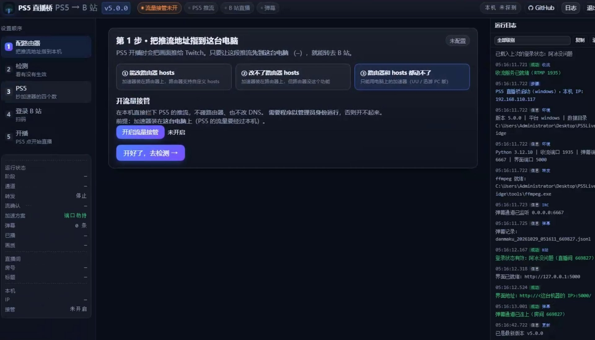
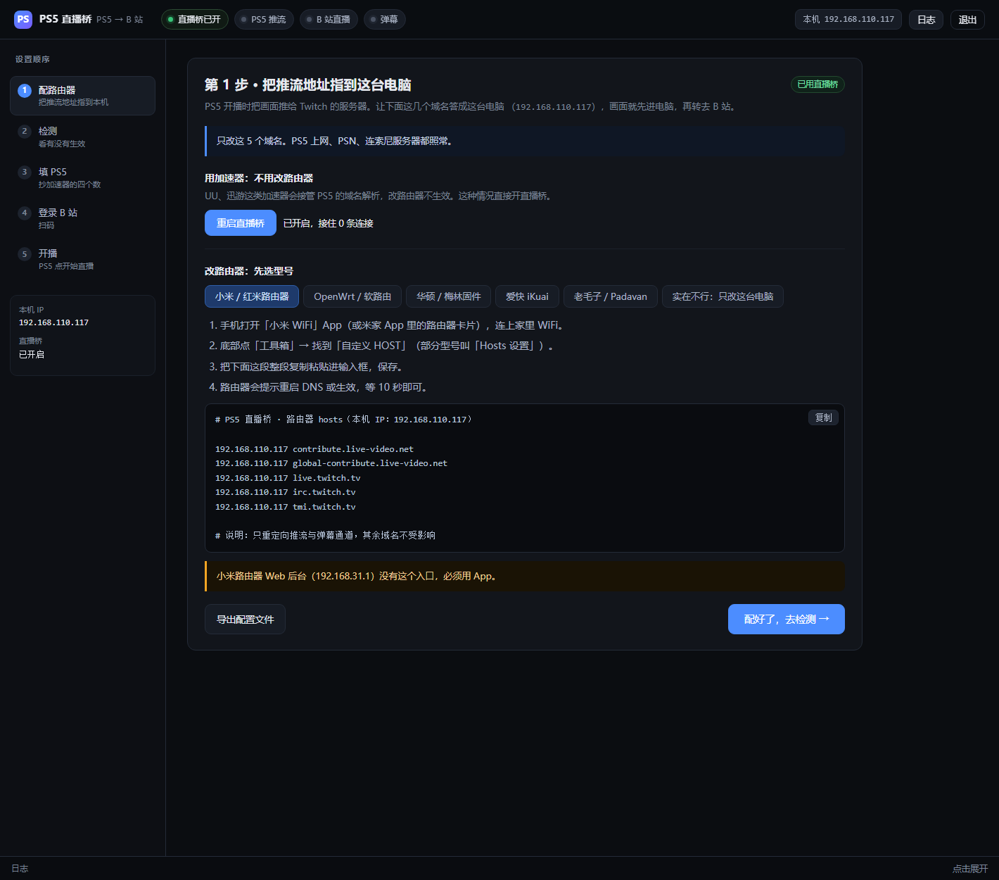
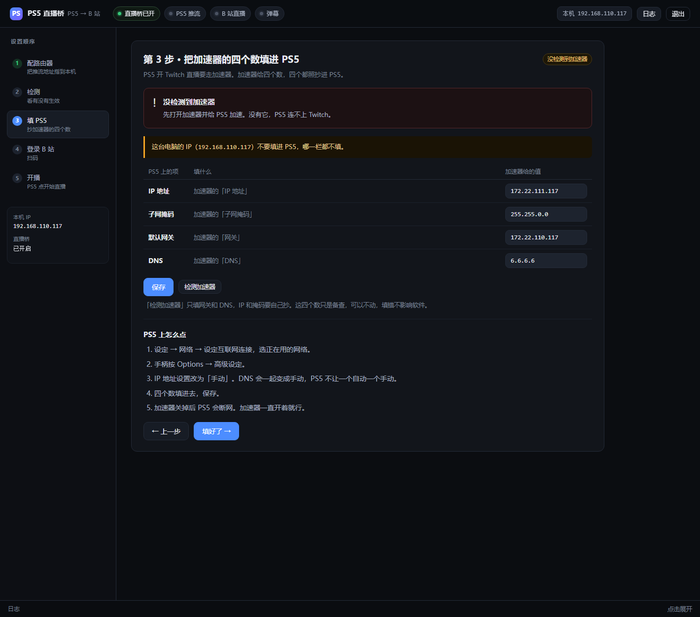
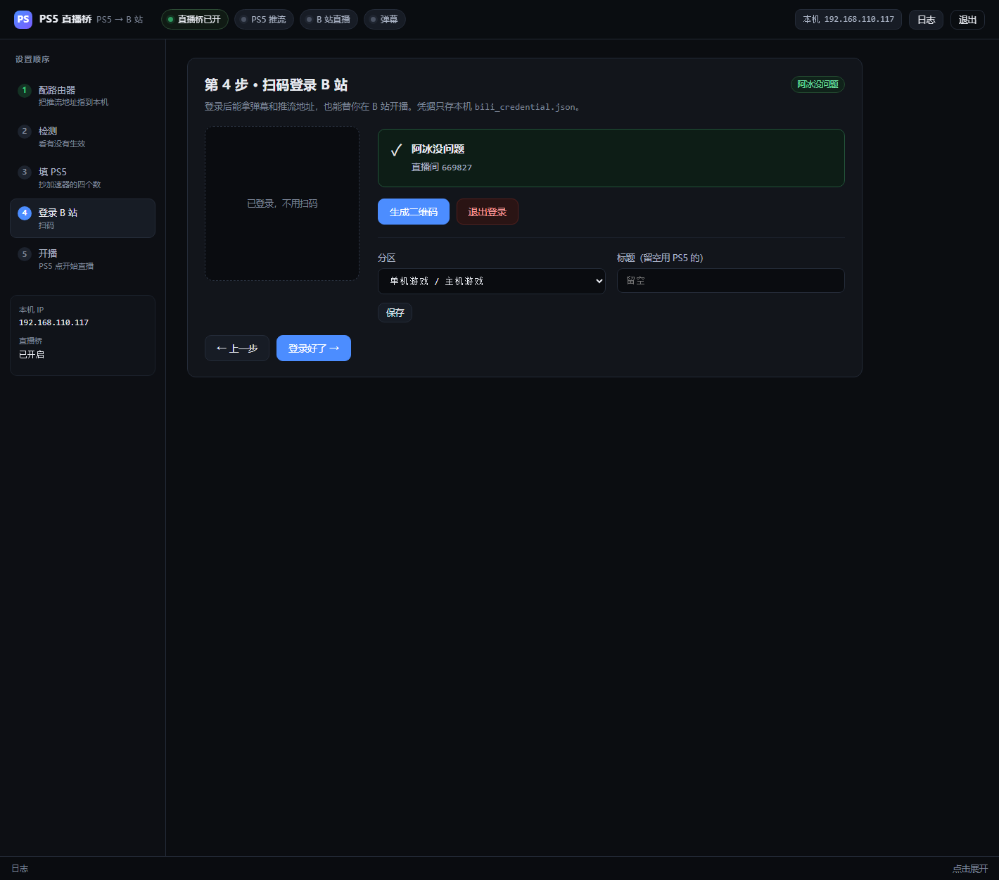
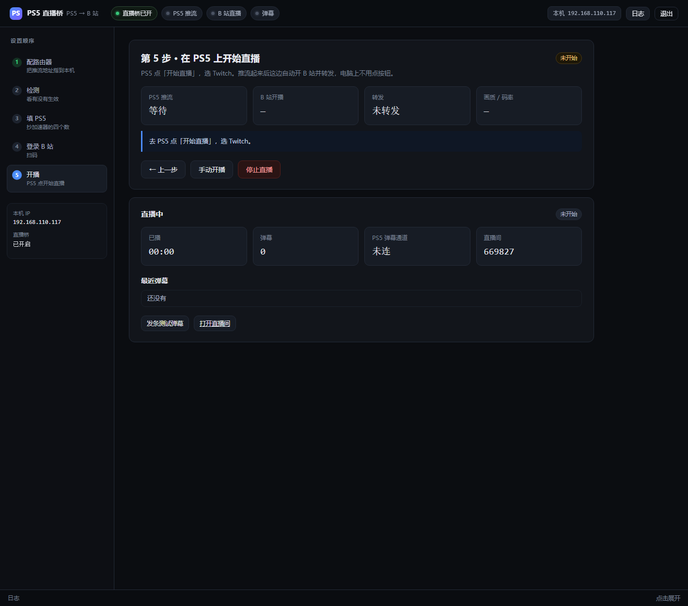

# PS5 直播桥 v5.0.1

<p align="center">
  
</p>

<p align="center">
  <a href="https://space.bilibili.com/2250922"></a>
  
</p>

把 PS5 的原生直播画面转到 B 站，B 站弹幕再送回 PS5 画面。
不破解、不装采集卡，全程在网络层解决。

本来原来的也能用，但是很多人弄不明白那个 DNS 劫持，索性用分步引导的方式重做了一个 Windows 版 —— 毕竟会弄容器的还是少数，所以这个项目以后以 Win 版为主，容器版同步升级。

两种跑法，功能一样，选一个：

| | 适合 | 加速器装在哪 |
|---|---|---|
| **Windows 桌面版** | 手边有一台常开的 Windows 电脑 | 路由器上、电脑上，都行 |
| **容器版** | 有 NAS / 常年开机的 Linux 机器 | 必须装在路由器上 |

桌面版成品在 [Releases](https://github.com/IceNoproblem/PS5LiveBridge/releases) 下载，解压即用。
容器版用本仓库的 `Dockerfile` 自己构建，见[容器版部署](#容器版)。

| 第 1 步 · 选你的情况 | 第 2 步 · 检测 |
|---|---|
|  |  |

| 扫码登录 | 开播 |
|---|---|
|  |  |

截图是 Windows 桌面版实际跑的界面。容器版界面一样，只是没有三选一那一屏 —— 它只有「改路由器」一条路。

---

## 功能

- PS5 点「开始直播」后，自动在 B 站开播并转发画面，电脑上不用点任何按钮
- B 站弹幕实时显示在 PS5 画面上，走 PS5 自带的 Twitch 弹幕通道
- PS5 停播后自动让 B 站关播
- 流复制转发，不转码，延迟 1~2 秒
- 可设 B 站分区、标题；标题留空会自动去 Twitch 抓 PS5 上填的那个
- 右侧常驻运行日志，带毫秒时间戳，能按级别过滤、一键复制
- 左侧实时状态：阶段、通道、转发、流确认、加速方案、弹幕数、已播时长、画质、房号、标题

## 三种方案

PS5 开 Twitch 直播必须走加速器。加速器装在哪、路由器让不让你动，决定了用哪种方式。
v5.0 起点就问你这个问题，点一下只展开对应那块。

### 方案一 · 加速器在路由器上，路由器能改 hosts

最省事的一种。把推流域名指到跑本程序的机器，PS5 什么都不用改，保持自动获取。

界面按路由器型号给了小米、OpenWrt、华硕、爱快等写法，可以直接复制粘贴。

**这里有个坑值得单独说：hosts 不支持通配符。**
写 `live-video.net` 只匹配它自己，不会匹配 `hkg06.contribute.live-video.net`。
而 PS5 连的是**具体地区节点**，不是主域名。所以生成的 hosts 现在是 20 条具体节点一条条列出来 —— 少列一个，PS5 恰好连到那个节点就会绕过本机直接推公网，表现是「开播了但没画面」。
dnsmasq 那套（OpenWrt / 梅林）支持后缀匹配，所以那种写法保持 `address=/live-video.net/...` 一行就够。

**容器版只能走这一种。**

### 方案二 · 加速器在路由器上，但改不了 hosts

这种情况以前是无解的，v5.0 加了条路：让跑程序的这台机器自己当 DNS。

推流域名和 Twitch 的域名都答成本机地址，然后把 PS5 的 DNS 指过来，其余照旧。

**但这条路必须再填一个代理服务器**，不是可选项。原因很简单：

```
这条路上 Twitch 的网页/API（443）也会被引到这台电脑，
国内直连 Twitch 不通，这台电脑必须有一个能出海的通道把它们转出去，
否则 Twitch 应用根本打不开，你也就点不到「开始直播」。
```

加速器是装在路由器上的，它只加速 PS5 的流量，帮不到这台电脑，所以这里要单独填一个。
填 `http://192.168.110.99:7890` 这种形式就行，局域网里另一台跑 Clash/mihomo 的机器也可以。

这个输入框和第 4 步的「Twitch 代理」是**同一个变量**，填一处两边同步。

### 方案三 · 路由器和 hosts 都动不了

那就把加速器装到电脑上，走端口级接管 —— 在本机直接拦 PS5 的推流连接，不碰路由器、也不改 DNS。

要管理员权限。

## v5.0.1 新增了什么

这一版加的都是「出问题能看见现场」的东西，不再靠猜。

**诊断面板。** 第 2 步下面多一块，本机和 Twitch 两栏并排：收流端口、弹幕端口、内置 DNS、443 中继、防火墙规则数、当前推流会话、直播阶段，对面是频道是否在播、上次直播时间、有没有历史录像、查询走的哪个代理。哪一环断了直接看出来。

**PS5 连接嗅探。** 抓 30 秒，看 PS5 到底往哪些端口发连接。Twitch 推流除了 1935，还有 2805-2899 一段备用端口；它要是连了备用端口又没连本机，推流就进不来，而界面上完全看不出来。抓包是只读的，包原样放回去，不拦不改。

**诊断包。** 一键打成 zip：脱敏后的配置（代理只留网段、凭据打码）、最近日志、nginx 的 error.log、全端口快照、Twitch 状态。用户出问题直接发这个包，不用再让他复述现象。

**代理栏可以留空。** 留空不等于没有代理 —— 程序会自己扫本机有没有 Clash / mihomo（7890、7897、7891、7892、10809、10808、2080、8080），探到就用，探不到才报错。两个代理输入框旁边都加了「检测」按钮：留空时测直连并扫本机，填了只测填的那一条，结果直接说人话（「直连到不了，但本机有现成的代理能用，留空会自动走它」）。

**增量更新。** 以前每次都得下 52MB，国内还经常下不动 —— 实测直连 release 的下载域名，20 秒拿不到响应头。现在发布侧多传两个东西：一个 manifest（每个文件的 sha256）和一个 300KB 的界面包。只有界面文件变了就下 300KB，动了 exe 才下全量。下载本身也改了：直连优先，失败依次换配置里的代理、本机代理、系统代理；支持断点续传；下完校验 sha256（以前只比大小，半截包也能过）。

**更新失败能回滚。** 老脚本是「先删旧文件、再拷新的」，拷到一半失败程序就废了。现在每一步都 catch，失败从备份整体还原，并在桌面留一份「更新失败.txt」说明发生了什么。

**调试日志开关。** 日志面板多了个「调试」按钮。打开后中继每次建连、嗅探抓到的每个包、每次 Twitch 查询都记下来；关着的时候一行都不写 —— 这些东西一直在记的话一天能写几十兆。诊断包里也标了这份日志是不是在调试模式下采的。

**容器版同步。** 上面除了端口嗅探（容器里没有 WinDivert，界面自动隐藏），其余容器版全有。

## v5.0 都改了什么

这一版改动比版本号看起来大，直接说了。

**收流端换回 nginx-rtmp。** 中间试过用 `ffmpeg -listen 1` 自己收流，行不通：它只接受一个连接，PS5 占住 1935 之后转发端拉不到流。想在同一个进程上再加转发目标，PS5 会被踢掉，而且不会自动重连。所以老老实实回到 nginx + 二次拉流，relay 仍然是 `-c copy`，字节级透传，画质跟源码流一模一样。

**修掉几个躺了很久的 bug。** 都是真机才会炸、代码看着没问题的：

- 转发线程里调了 `Thread.cancel()` —— `threading.Thread` 没这个方法。第一次开播正常，**停播后再开播必炸**。
- 清理顺序写反了：先清空 `live["bili"]` 再去取里面的 channel，关播永远用错通道。
- 判断「PS5 在推流」用的是 `frame > 0`，而 `-c copy` 不解码，frame 恒为 0 —— 永远认为没推流，不自动开播。改成看 `out_time_ms` 有没有增长。
- 开播、人脸验证那几个循环没有异常保护，网络一抖线程就静默死掉，状态永远卡在「正在开播」。

**中继（443）踩了两个坑。** 内置 DNS 这条路要把 HTTPS 也接住，所以写了个 TCP 中继。第一版 `join(timeout=30)`，Twitch 的状态同步连接一到 30 秒就被掐断，应用报「无法直播」；第二版读 ClientHello 只 `recv(4096)` 一次，碰上分段发送就解析不出 SNI，然后默认猜成 `api.twitch.tv` —— 猜错就把 ingest 的流量送到 api 的服务器上，PS5 那边报 `SSL_ERROR_SYSCALL`。现在按 TLS 记录头长度读完整条，SNI 读不出就明确报错，不猜。

**`api.twitch.tv` 必须一起劫持。** 之前只劫推流域名，PS5 拿公网 IP 去连，被墙，Twitch 打不开。加上 `twitch.tv` 后缀之后才通。

**B 站域名绝对不能进 hosts。** 这套劫持是给 PS5 找推流地址用的，PS5 只推 Twitch；往 B 站推的是本机 ffmpeg，走系统 DNS。把 `bilivideo.com` 写进路由器 hosts，本机 ffmpeg 解析它就会得到自己，于是「推流给自己」，报 `I/O error`，直播永远起不来。这一版在生成 hosts 时直接过滤掉，代码里也不留。

**界面重做成三选一。** 老版本把「改路由器」「开接管」一股脑摊在一页，字多到劝退。现在第一步就问你在哪种情况，点哪个只展开哪块，第 2 步、第 3 步的检测标准和填法也跟着分支走 —— 走 hosts 的人不该被要求填那四个数，走接管的也不该被问 DNS。

**顺手加了些实用的东西。** 日志带毫秒（开播链路几秒内十几条，只到秒分不清先后）、左栏能看画质（分辨率/帧率/码率）、DNS 查询全量落盘（内存里那几条环形缓冲一冲就没了，排查“某个域名到底有没有来查”根本不够用）。

**还留着的坑：**

- PS5 重启后 DNS 设置会丢。走内置 DNS 的用户每次都要去 PS5 重设一遍，这件事没解 —— 要做就得让程序自动发现 PS5 并指导它，那是另一摊。
- 中继是 Python 每连接两个线程，Twitch 应用连接一多就有压力。目前够用，没到要改的时候。
- 地区节点列表是硬编码的 20 个。Twitch 哪天加了新节点，得手动补。

## 桌面版

下载对应系统的压缩包，解压，双击 `PS5LiveBridge.exe`。

第一次启动会要管理员权限（要绑 53、1935、6667，还要动防火墙），点「是」。

数据都在程序同目录（`config.json`、`logs/`、`data/`），整个文件夹拷走就能换机器，删掉就是卸载。

## 容器版

```bash
git clone https://github.com/IceNoproblem/PS5LiveBridge.git
cd PS5LiveBridge
docker build -t ps5livebridge .
docker run -d --name ps5-live-bridge \
  --network host \
  -v /your/data:/data \
  -e PS5LB_DATA_DIR=/data \
  ps5livebridge
```

`--network host` 是必须的：它要直接占 1935 / 6667 / 53，走 bridge 网络这些端口出不去。

容器版只有「加速器在路由器上 + 改路由器 hosts」这一条路，因为它动不了宿主机的网络栈。

## 一些数字

实测 1080p60 / 6.1 Mbps：

| 组件 | CPU |
|---|---|
| ffmpeg（copy + FLV 封装 + 推 B 站） | 2.3% |
| nginx-rtmp（收流） | ~1.5% |
| Python（Flask + 监控 + 弹幕） | ~1.7% |
| 合计 | 5.5%，内存 67 MB |

## 常见问题

**开播了，B 站显示直播中，但没画面。**
先看左侧「画质」有没有值。没有就是推流没进来 —— 大概率是 PS5 连的地区节点没在 hosts 里。用 `nslookup` 查一下它连的哪个，补进去。

**Twitch 打不开。**
内置 DNS 那条路上，检查第 4 步或第 1 步的代理填了没、通不通。443 转发不出去，Twitch 就是打不开。

**提示「其他设备正在播放」。**
上次退出时没正常关播。等几分钟，或者去 B 站直播间后台手动关一次。

**PS5 上的 Twitch 字幕、聊天室不显示。**
正常。弹幕是走 Twitch 的 IRC 通道送回去的，PS5 那边看到的是它自己的聊天室，不是 B 站的。

## 许可

MIT。

---

鸣谢**PSLinkB**
